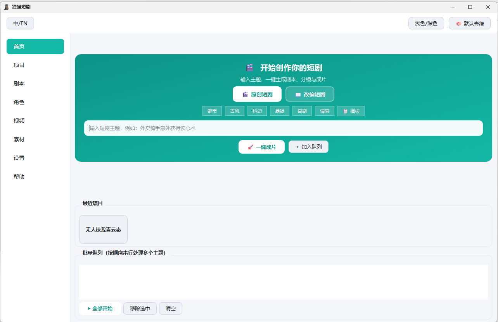
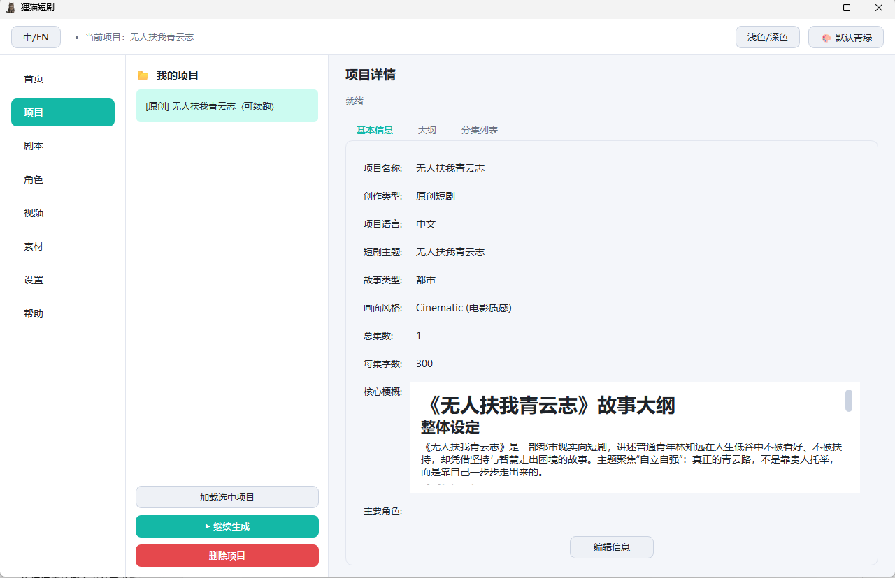
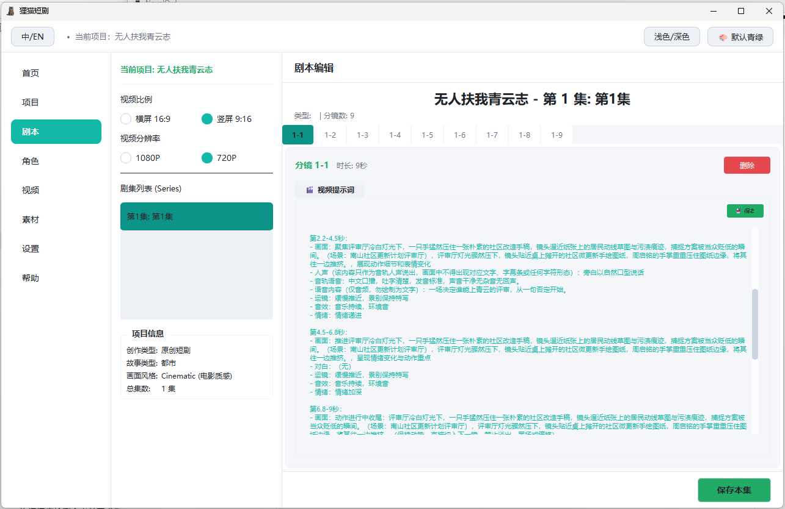
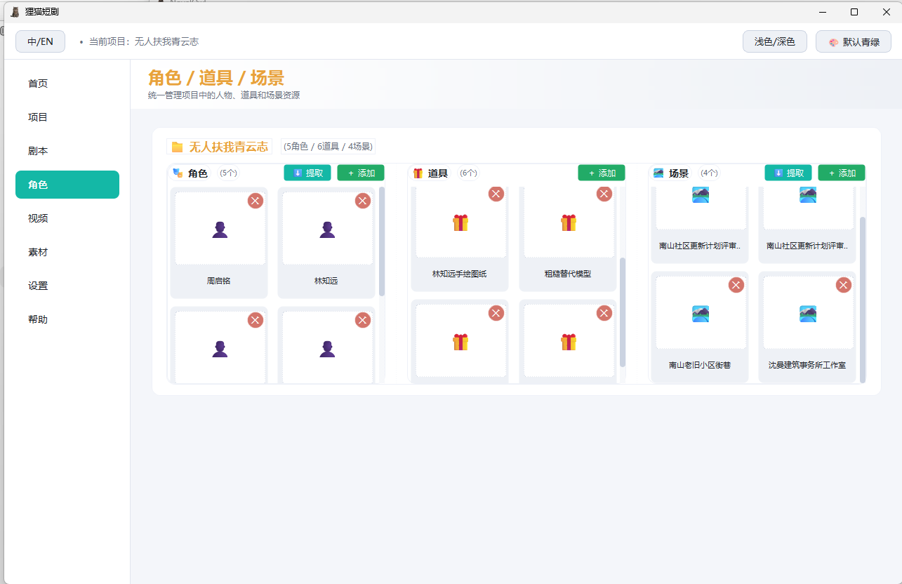
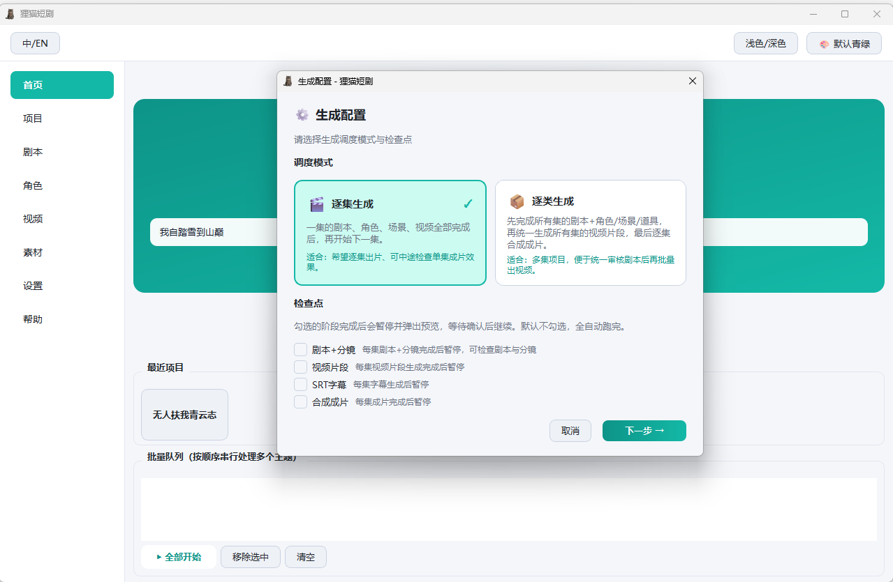
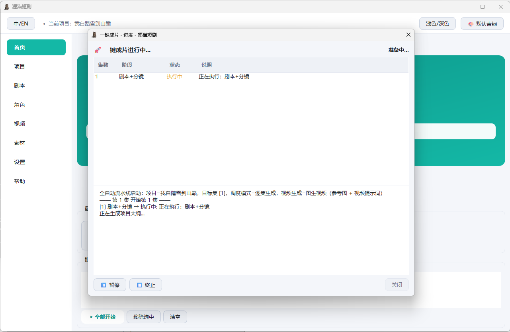
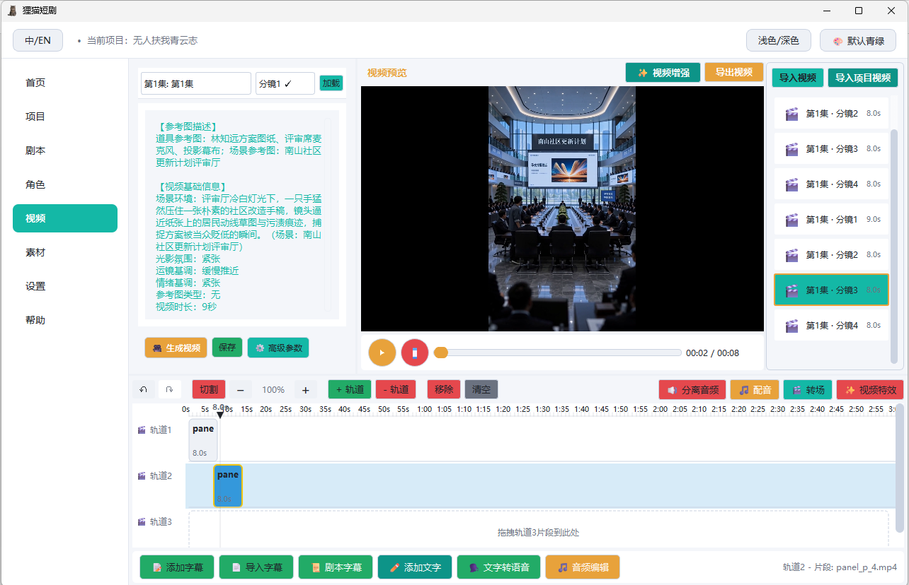
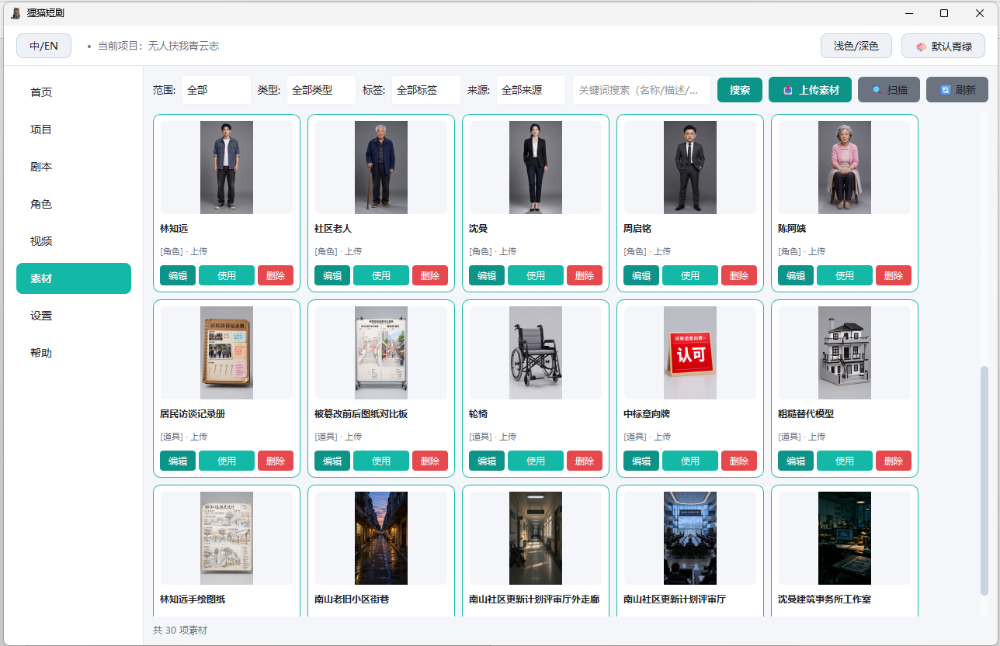
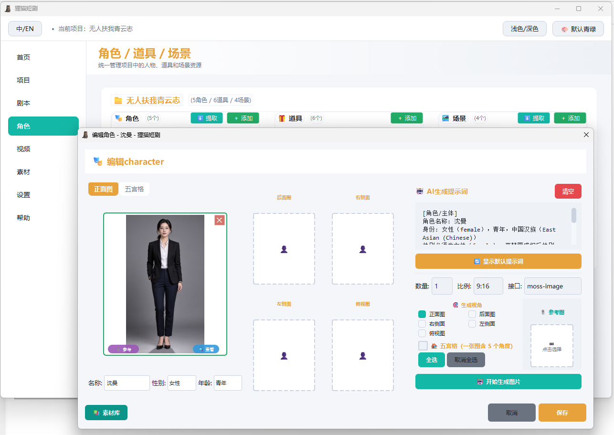
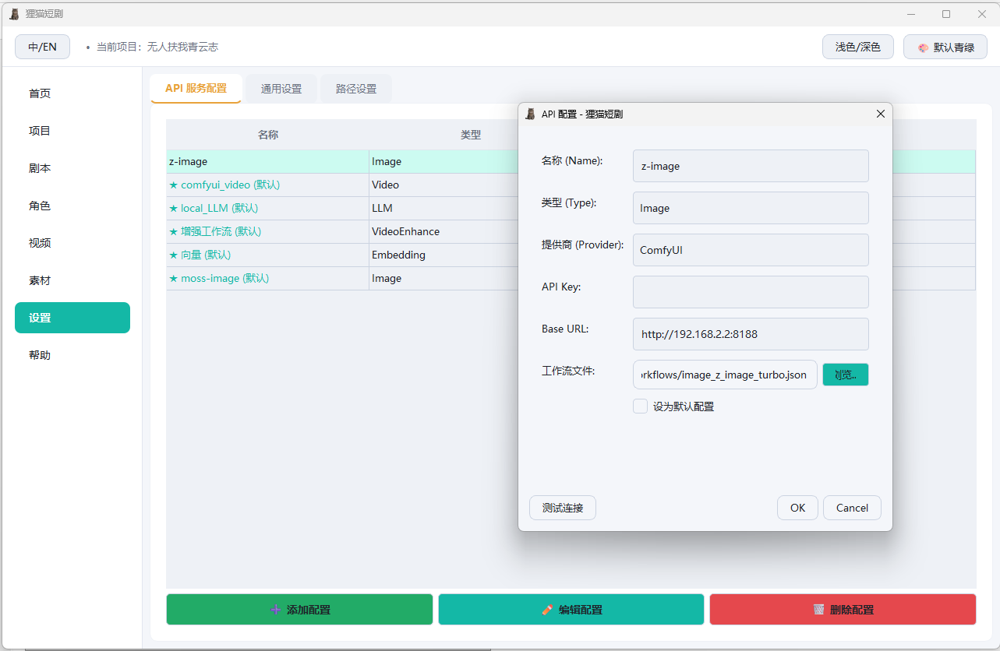

#  狸猫短剧 (Dragonli)

[](LICENSE)
[](https://www.python.org/downloads/)
[](https://www.riverbankcomputing.com/software/pyqt/)

[English](README_EN.md) | **中文**

> ## 本地化 · 自动化 · 简单化 · 多样化
>
> **装在你自己电脑里的 AI 短剧工作室**：输入一个主题，自动跑完剧本、分镜、视频、字幕，直接导出成片。
>
> 密钥、项目、素材与成片全部留在本机；需要时还能换成 Ollama / LM Studio + ComfyUI 的全本地链路，数据不出网。
>
> 简单不等于单薄：原创与改编、15 种题材、云端与本地模型混搭、竖屏横屏多平台导出，都在同一条流水线里。
>
> 👉 想直接上手？跳到 [使用指南](#usage)。

---

## 📥 下载与演示

- **Windows 单文件版**：前往 [Releases](https://github.com/frank36512/dragonli/releases) 下载 `Dragonli.exe`，双击即可运行。
- **夸克网盘镜像**：[https://pan.quark.cn/s/337e9e697935](https://pan.quark.cn/s/337e9e697935) —— 国内下载更方便，无需 GitHub 账号，文件与 Releases 中的 `Dragonli.exe` 为同一版本。
- **截图 / 演示视频**：见下方 [界面预览与样片](#screenshots)。

---

<a id="screenshots"></a>

## 📸 界面预览与样片

> 以下截图来自软件实际运行界面（示例项目：《无人扶我青云志》），点击图片可查看大图。

| 首页 · 一键成片入口 | 项目 · 项目详情与大纲 |
| :---: | :---: |
| [](shots/1.png) | [](shots/2.png) |

| 剧本 · 分镜编辑与视频提示词 | 角色 / 道具 / 场景 · 一致性素材管理 |
| :---: | :---: |
| [](shots/3.png) | [](shots/4.png) |

| 生成配置 · 调度模式与检查点 | 一键成片 · 实时进度与日志 |
| :---: | :---: |
| [](shots/5.png) | [](shots/6.png) |

| 视频编辑器 · 分镜预览与时间轴剪辑 | 素材库 · 角色 / 道具 / 场景素材 |
| :---: | :---: |
| [](shots/7.png) | [](shots/8.png) |

| 角色编辑 · 参考图与 AI 生成提示词 | 设置 · API 服务配置与测试连接 |
| :---: | :---: |
| [](shots/9.png) | [](shots/10.png) |

### 🎬 样片演示

[](shots/%E6%A0%B7%E7%89%871.mp4)

**《无人扶我青云志》样片**（约 26 秒，9:16 竖屏）— [▶ 观看 / 下载 MP4](shots/%E6%A0%B7%E7%89%871.mp4)（11.6 MB）

---

## 🎯 为什么选择狸猫短剧

| 你关心的 | 常见做法 | 狸猫短剧 |
| --- | --- | --- |
| **数据与隐私** | 剧本、素材上传到在线平台 | 项目、密钥、素材、成片全在本机，推理服务可选本地，可全程不出网 |
| **制作流程** | 编剧、绘图、剪辑、字幕、配音在多个工具间来回倒腾 | 一个主题 → 🚀 一键成片，四个阶段自动串起来 |
| **上手门槛** | 配环境、写提示词、懂剪辑 | 双击 exe → 填一个服务 → 点一下，全程图形界面 |
| **能力覆盖** | 一个工具只解决一个环节 | 原创/改编、多题材、多模型、多平台规格与三种使用入口，一条流水线全覆盖 |

### 🏠 本地化 · 你的电脑就是整间工作室

- **数据不出本机**：项目以 JSON 和媒体文件的形式存在 `resources/projects/` 下，没有账号体系、没有云端同步。整个文件夹拷走就是完整备份，删掉就是彻底删除。
- **密钥只属于你**：API Key 只写进本机 `resources/config/config.json`（已被 Git 忽略）；程序只会把请求发给你在配置中亲自指定的服务地址。
- **推理服务自己选**：LLM 既可用 OpenAI / DeepSeek 等云端 API，也可接本机或局域网的 **Ollama、LM Studio、vLLM、llama.cpp**。程序会自动按需加载模型、失败重试、用完卸载释放显存，本地服务无需真实密钥。
- **图像与视频可全本地**：支持 **ComfyUI**（本机 `127.0.0.1:8188` 或局域网地址），内置 8 个工作流（出图、图生视频、去模糊、去水印、补帧、超分等），无需 API Key；未配置增强工作流时自动回退到本地 FFmpeg 处理。
- **配音与合成也在本地**：可选用系统离线 TTS（pyttsx3，无需联网），成片拼接、字幕烧录、BGM 混音都由本地 FFmpeg 完成。
- **中文优先**：中文界面 + 中英一键切换；内置 15 个中文短剧题材模板（重生、复仇、宫斗、甜宠、系统流……），剧本格式与提示词按中文短剧习惯设计。
- **单文件可携带**：`Dragonli.exe` 双击即用，资源自动释放到 exe 同级目录，且不会覆盖你已有的配置文件。

> 💡 云端与本地都是**可选项**：默认使用云端 API，可能产生服务商费用；把 LLM、图像、视频、TTS 都换成本地服务后，整条链路可以不联网。

### ⚙️ 自动化 · 从一句话到一条成片

- **🚀 一键成片**：输入主题，自动串起四个阶段 —— `剧本+分镜（含角色/场景/道具提取与参考图）` → `视频片段` → `SRT 字幕` → `拼接+烧录字幕成片`，进度与日志实时可见。
- **一致性自动维护**：自动抽取角色、场景、道具并生成参考图；视频提示词自动带上「参考图一致性约束」「画面禁止出现文字/字幕/水印」等规则；续跑时还会自动补齐缺失的参考图。
- **断点续跑**：每集每阶段的状态都会落盘。中断后重开自动跳过已完成部分，不重复烧钱；失败的阶段可单独重试。
- **批量队列**：多个主题排进队列按顺序串行跑完，适合批量出片；调度方式可选「逐集生成」或「逐类生成」。
- **想审就审**：可勾选检查点，在关键阶段暂停预览、确认后再继续；不勾选就一路自动跑完。
- **其他自动化**：角色/场景自动提取、按说话人匹配角色音色批量配音（视频编辑器）、本地模型自动加载与重试、字幕自动生成与烧录。

### 🎈 简单化 · 打开就会用

- **免安装、免命令行**：下载 `Dragonli.exe` 双击打开；源码用户用 `start.bat` 或 `python src/main.py` 一行启动。
- **三步出片**：设置里填一个 LLM 服务（配置面板自带「测试连接」，填错立刻知道）→ 首页输入主题或挑一个题材模板 → 点 🚀 一键成片。
- **全程图形界面**：项目管理、剧本编辑、角色/场景/道具库、分镜面板、视频编辑器、进度弹窗都是点选操作，不需要写提示词或脚本。
- **可繁可简**：新手只用一个按钮；进阶用户仍可用 CLI、HTTP API、自定义 ComfyUI 工作流和多套 API 配置切换。

### 🧩 多样化 · 简单不等于单薄

- **两种创作起点**：**原创短剧**（输入主题 + 6 种风格 + 15 个题材模板）或 **改编短剧**（粘贴/导入小说原作，设定改编幅度与目标平台）。
- **模型自由混搭**：LLM、图像、视频、TTS、视频增强、Embedding 各自独立配置，可同时保存多套配置随时切换；云端 API 与本地 Ollama / ComfyUI 可以混着用，例如「本地 LLM + 云端视频」。
- **多种生成方式**：一键成片全自动、逐环节手动精修、批量队列串行出片；调度可选逐集或逐类，规模支持 1–1000 集与多集项目管理。
- **多种成片规格**：抖音 / TikTok / 快手竖屏 9:16、B站 / YouTube 横屏 16:9 以及自定义导出预设，画面比例、分辨率、帧率、篇幅、语言、转场都可调整。
- **多种后期能力**：时间轴剪辑、音轨与 TTS 批量配音、SRT 字幕烧录、BGM 混音，外加 8 个 ComfyUI 工作流（2 个出图、1 个图生视频、5 种视频增强）。
- **多种使用入口**：GUI 的 8 个功能页（首页 / 项目 / 剧本 / 角色 / 视频 / 素材 / 设置 / 帮助）、CLI、HTTP API；中英界面、深浅主题与多套皮肤。

---

## 📖 简介

**狸猫短剧 (Dragonli)** 是一款本地运行的 AI 短剧创作工作台，把剧本创作、角色与场景设定、分镜、视频生成、字幕与配音整合进一条自动化流水线。它不要求你注册平台账号，也不要求你精通提示词或剪辑：给一个主题，剩下的交给流水线；想深度干预时，每个环节又都能单独打开调整。

无论你是独立创作者还是小团队，都能用它保持角色一致性、批量产出短剧，并把全部素材留在自己手里。

---

## ✨ 核心功能

### 📝 智能剧本管理
- **AI 辅助写作**: 通过 OpenAI 兼容接口或本地模型生成剧本、对话与场景描述。
- **格式标准化**: 自动整理为可直接用于分镜的结构化剧本。
- **题材模板**: 15 个预置中文短剧模板，选一个就能起步。

### 🎨 角色一致性系统
- **档案管理**: 定义角色特征、外貌与背景故事。
- **参考图管理**: 自动/手动生成并管理角色、场景、道具参考图，作为图生视频的一致性锚点。

### 🎥 AI 视频生成
- **多后端支持**: 云端 API（Veo、Runway 等）与本地 ComfyUI 工作流并用。
- **图生视频**: 按分镜的角色/场景/道具参考图配合视频提示词直接生成片段。
- **视频增强**: 去模糊、去水印、补帧、超分等工作流，未配置时回退本地 FFmpeg。

### 🗣️ 音频与字幕
- **TTS**: 支持 OpenAI 兼容 TTS、声纹克隆（sovit）与系统离线 TTS（pyttsx3）。
- **批量配音**: 视频编辑器中按说话人匹配角色音色，批量生成配音。
- **字幕**: 自动依据分镜生成 SRT，成片阶段自动烧录；支持叠加自定义 BGM。

### 🎬 可视化分镜与剪辑
- **分镜面板**: 镜头、对白、运镜、音效与情绪按秒级分段规划。
- **视频编辑器**: 时间轴、音轨、配音与导出，成片前后都能手动微调。

---

<a id="usage"></a>

## 🎬 使用指南

> 只想尽快出片看 **A**；想逐环节精修看 **B**；批量出片与续跑看 **C**；接本地模型看 **D**；命令行/API 看 **E**。侧栏「帮助」页里也有一份内置说明。

### A. 三步出片（最简路径）

**第 1 步 · 配置一个 AI 服务**

打开侧栏 **设置 → API 配置 → ➕ 添加配置**，选择类型（LLM / Image / Video / TTS 等）与服务商，填 `base_url`、模型名和密钥，点 **测试连接**，提示成功后保存。

- 云端：填服务商提供的 API Key。
- 本地：`base_url` 填 `http://127.0.0.1:1234/v1`（LM Studio）或 `http://127.0.0.1:11434/v1`（Ollama），密钥可填任意占位值如 `sk-local`。
- **至少配置一个 LLM 就能开始**；图像、视频、TTS 可以稍后再补。

**第 2 步 · 输入主题**

回到 **首页**，选择 **🎬 原创短剧** 或 **📖 改编短剧**：

- 原创：挑一种风格（都市 / 古风 / 科幻 / 悬疑 / 喜剧 / 情感），或点 **📋 模板** 用预置题材快速填充，然后输入主题，例如「外卖骑手意外获得读心术」。
- 改编：粘贴小说/原著内容，或点 **导入** 选择文本文件，稍后在弹窗里设定改编幅度与目标平台。

**第 3 步 · 一键成片**

点 **🚀 一键成片**（改编模式为 **🎭 改编成片**），在两步配置弹窗里设置：

1. **生成配置**：选「逐集生成」或「逐类生成」，按需勾选检查点（不勾选 = 全程自动跑完）。
2. **剧本参数**：集数、画面比例、分辨率、篇幅、语言、画面风格、导出预设 / 目标平台、转场等。

确认后进度弹窗依次跑完 `剧本+分镜 → 视频片段 → SRT 字幕 → 合成成片`，可实时查看每集每阶段的状态与日志，也可暂停或终止。

**成片在哪**：`resources/projects/<项目名>/output/episode_<集号>_final.mp4`。项目目录下的 `scripts/`、`images/`、`clips/`、`subtitles/`、`audio/` 保存了各阶段中间产物，都能单独打开修改。

### B. 逐环节精修（不想全自动时）

侧栏 8 个页面对应完整流程：

| 页面 | 你能做什么 |
| --- | --- |
| **首页** | 一键成片、批量队列、最近项目 |
| **项目** | 新建/打开项目、按集管理、继续生成 |
| **剧本** | 编辑剧本、AI 生成与改编、批量改编多集、生成视频提示词 |
| **角色** | 统一管理角色 / 道具 / 场景，自动提取、生成参考图 |
| **视频** | 分镜视频生成、时间轴剪辑、TTS 配音、字幕、BGM、导出 |
| **素材** | 素材库与资源浏览 |
| **设置** | API 配置、Embedding、界面语言/主题、工作流 |
| **帮助** | 内置使用说明与常见问题 |

推荐顺序：**项目 → 剧本 → 角色（确认参考图）→ 分镜与视频片段 → 视频编辑器配音导出**。任何一步都能单独重做，不必重跑整条流水线。

### C. 批量出片、断点续跑与检查点

- **批量队列**：首页填好主题后点 **＋ 加入队列**，多个主题按加入顺序串行执行，适合一次跑一整季。
- **断点续跑**：中途关闭或失败后，从「最近项目」或「项目」页重新打开，已成功的阶段会自动跳过（状态显示 `cached`），只补跑剩余部分；失败阶段可单独重试。
- **检查点**：在生成配置里勾选阶段，跑到该阶段会暂停并解锁主窗口供你修改剧本/分镜，确认后继续；默认不勾选即全自动。

### D. 全本地链路（可选，数据不出网）

| 环节 | 配置方式 |
| --- | --- |
| LLM | 把 LLM 配置的 `base_url` 指向本机 Ollama / LM Studio / vLLM / llama.cpp |
| 图像 / 视频 | 添加 `Image` / `Video` 配置，provider 选 **ComfyUI**，地址填 `http://127.0.0.1:8188`，并选中 `resources/workflows/` 下的工作流 |
| 视频增强 | 为去模糊 / 去水印 / 补帧 / 超分分别指定工作流；留空则回退本地 FFmpeg |
| TTS | provider 选 `system`（pyttsx3 离线），也可用 sovit 声纹克隆 |
| 合成 | 无需配置，本地 FFmpeg 自动完成拼接与字幕烧录 |

全部切到本地后不需要任何 API Key；混合使用同样可以，例如「本地 LLM + 云端视频」。

### E. 命令行与 HTTP API（进阶）

```bash
# CLI：创建项目、跑完整流水线
python src/main.py --cli --task create_project --project "我的短剧"
python src/main.py --cli --task full_pipeline --topic "外卖骑手获得读心术" --episodes 3

# HTTP API：启动后打开 http://127.0.0.1:18790/docs 查看交互文档
python src/main.py --api --port 18790
```

常用端点：`/api/project/create`、`/api/script/generate`、`/api/video/generate`、`/api/video/compose`、`/api/pipeline/full`、`/api/pipeline/auto` 及其 `/status`、`/resume`。

### 💡 小贴士

- 云端 API 按量计费，建议先用 **1 集 + 检查点** 试跑，确认效果再批量。
- 视频生成耗时较长，进度弹窗的日志会显示当前阶段，请耐心等待。
- FFmpeg 未加入 PATH 时程序会尝试 `imageio-ffmpeg` 自带的二进制；导出异常可优先检查它。
- 密钥只存在本机 `resources/config/config.json`，不要提交到仓库，也不要出现在截图里。

---

## 🛠️ 技术栈

- **语言**: Python 3.10+（推荐 3.11）
- **GUI 框架**: PyQt6
- **LLM**: OpenAI 兼容 API / DeepSeek / Ollama / LM Studio / vLLM / llama.cpp
- **图像与视频**: OpenAI 兼容图像接口、Google、Veo、Runway、ComfyUI 本地工作流
- **音频**: OpenAI 兼容 TTS、sovit 声纹克隆、pyttsx3 离线 TTS
- **媒体处理**: FFmpeg、OpenCV、Pydub
- **服务与数据**: FastAPI HTTP API、CLI、基于 JSON 的本地项目结构

---

## 📂 项目结构

```text
Dragonli/
├── src/
│   ├── main.py              # GUI 入口
│   ├── cli.py               # 命令行入口
│   ├── api/                 # HTTP API（FastAPI）
│   ├── ui/                  # PyQt6 界面（含一键成片、视频编辑器）
│   ├── core/                # 剧本 / 角色 / 分镜 / 自动流水线 / 合成等业务逻辑
│   ├── ai_engine/           # LLM、图像、视频、音频客户端
│   ├── i18n.py              # 中英文界面切换
│   └── paths.py             # 运行路径与本地资源初始化
├── resources/
│   ├── config/              # 配置模板 config.example.json
│   ├── templates/           # 15 个预置短剧剧本模板
│   ├── workflows/           # ComfyUI / 视频增强工作流
│   ├── icons/               # 界面 SVG 图标
│   └── characters|scenes|props|projects/  # 运行时生成的用户数据（不入库）
├── build_exe.spec           # PyInstaller 打包配置
├── requirements.txt         # 依赖清单
├── start.bat                # Windows 快速启动
└── LICENSE
```

---

## 🚀 快速开始

### 前置要求

- **Python 3.10+**（推荐 3.11）。
- **FFmpeg**：需加入系统 PATH；未安装时程序会尝试使用 `imageio-ffmpeg` 自带的二进制。
- **Windows**：GUI 与打包脚本面向 Windows，核心业务逻辑为纯 Python。
- 至少准备**一个 LLM 服务**：云端 API 密钥，或本机已启动的 Ollama / LM Studio。

> 只想快速体验？从 [Releases](https://github.com/frank36512/dragonli/releases) 或 [夸克网盘](https://pan.quark.cn/s/337e9e697935) 下载 `Dragonli.exe`，跳过下面的安装步骤，打开后在设置里填一个 LLM 服务即可。详细操作步骤见 [使用指南](#usage)。

### 安装步骤

1.  **克隆仓库**:
    ```bash
    git clone https://github.com/frank36512/dragonli.git
    cd Dragonli
    ```

2.  **创建虚拟环境**:
    ```bash
    # Windows
    python -m venv .venv
    .venv\Scripts\activate

    # Linux/macOS
    python3 -m venv .venv
    source .venv/bin/activate
    ```

3.  **安装依赖**:
    ```bash
    pip install -r requirements.txt
    ```

### 配置指南

复制示例配置，填入你所用服务的 API 密钥；若使用本地模型，把 `base_url` 指向 `http://127.0.0.1:1234/v1` 之类的本地地址，密钥可填任意占位值。

```bash
# Windows
copy resources\config\config.example.json resources\config\config.json

# Linux/macOS
cp resources/config/config.example.json resources/config/config.json
```

> ⚠️ `resources/config/config.json` 及所有 `*.bak*` 备份都已被 `.gitignore` 忽略。请勿强制提交，也不要把真实密钥写进 `config.example.json`、Issue、PR、日志或截图。

### 运行应用

```bash
python src/main.py                      # 图形界面
start.bat                               # Windows 快捷启动
python src/main.py --cli --help         # 命令行模式
python src/main.py --api --port 18790   # HTTP API，交互文档在 /docs
```

### 打包（Windows）

```bash
python -m PyInstaller build_exe.spec --noconfirm --clean
# 产物：dist/Dragonli.exe
```

---

## 🔐 隐私与安全

- API 密钥仅保存在本地配置文件；程序只会把请求发送给你在配置中指定的服务商。切换到本地推理服务后，可做到数据不出网。
- 使用云端 AI 服务可能产生费用，费用由使用者自行承担。
- 生成内容的版权与合规性由使用者自行审查和负责。
- 请勿把密钥、`resources/projects/` 下的项目数据或生成的媒体文件提交到仓库；一旦怀疑密钥泄漏，请立即在服务商处轮换。

## ⚠️ 免责声明

本项目与 OpenAI、Google、DeepSeek 等服务商没有官方关联，文中模型名称仅用于说明兼容性。本项目按「原样」提供，不附带任何明示或暗示的担保。

---

## 🗺️ 开发计划

- [x] **第一阶段：基础建设** - 基础 UI、本地项目管理、剧本编辑器。
- [x] **第二阶段：AI 核心** - LLM 剧本创作、角色/场景/道具提取与参考图一致性。
- [x] **第三阶段：视频合成** - 图生视频片段流水线与 ComfyUI 本地工作流。
- [x] **第四阶段：字幕与音频** - SRT 自动生成与烧录、TTS 配音、BGM 混音。
- [x] **第五阶段：打磨** - 一键成片、断点续跑、批量队列、时间轴编辑与导出。
- [ ] **规划中** - 把已有的 Veo 口型同步 / 音效客户端接入一键成片流水线；目前成片口型依赖视频模型自身生成。

---

## 🤝 贡献指南

欢迎贡献代码！请阅读 [CONTRIBUTING.md](CONTRIBUTING.md) 了解开发环境搭建与提交拉取请求（Pull Request）的流程。

---

## 📬 联系方式

- **问题反馈 / 功能建议**：优先通过 [GitHub Issues](https://github.com/frank36512/dragonli/issues) 提交，便于追踪和公开讨论。
- **邮件联系**：[frank36512@gmail.com](mailto:frank36512@gmail.com)，适用于合作咨询、使用交流或不便公开的问题。

---

## 📄 许可证

本项目采用 Apache License 2.0 许可证 - 详情请参阅 [LICENSE](LICENSE) 文件。
