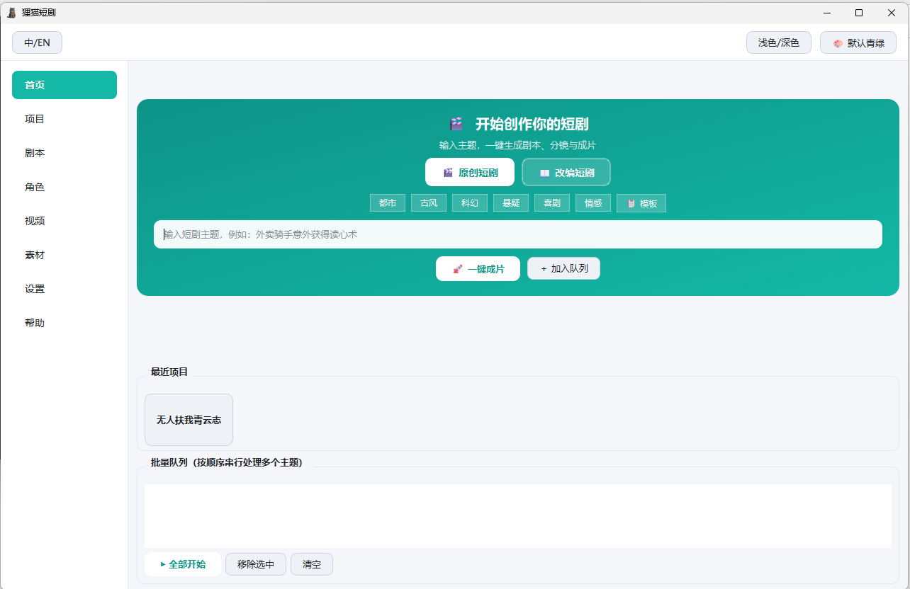
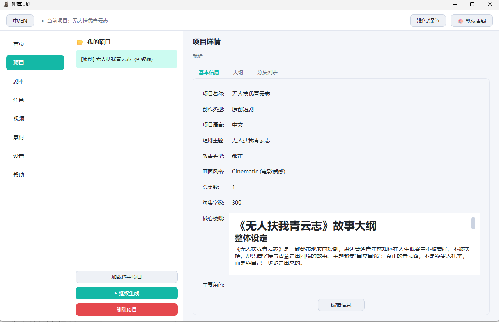
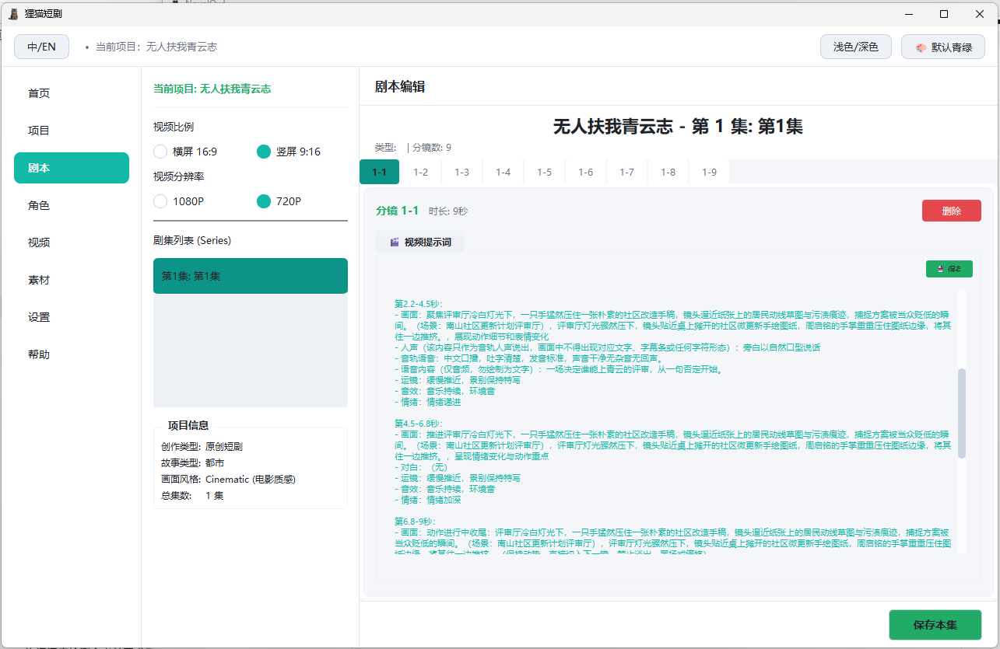
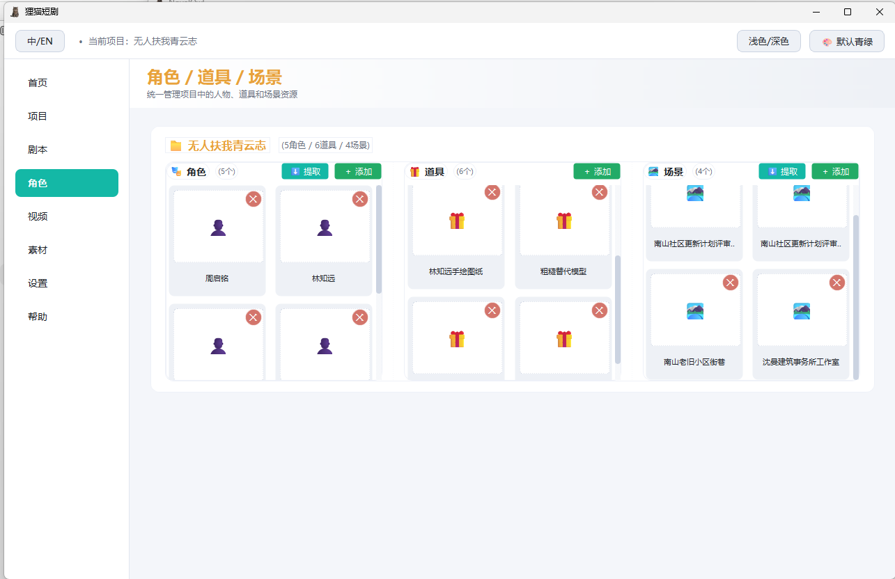
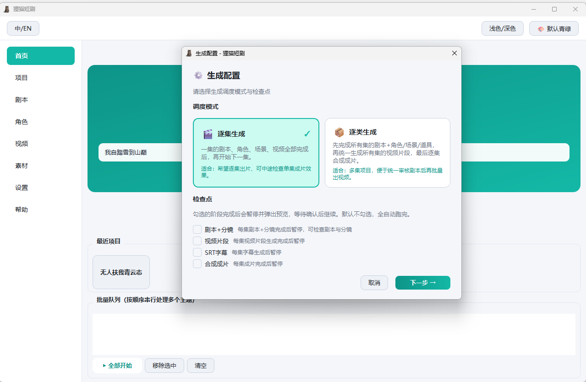
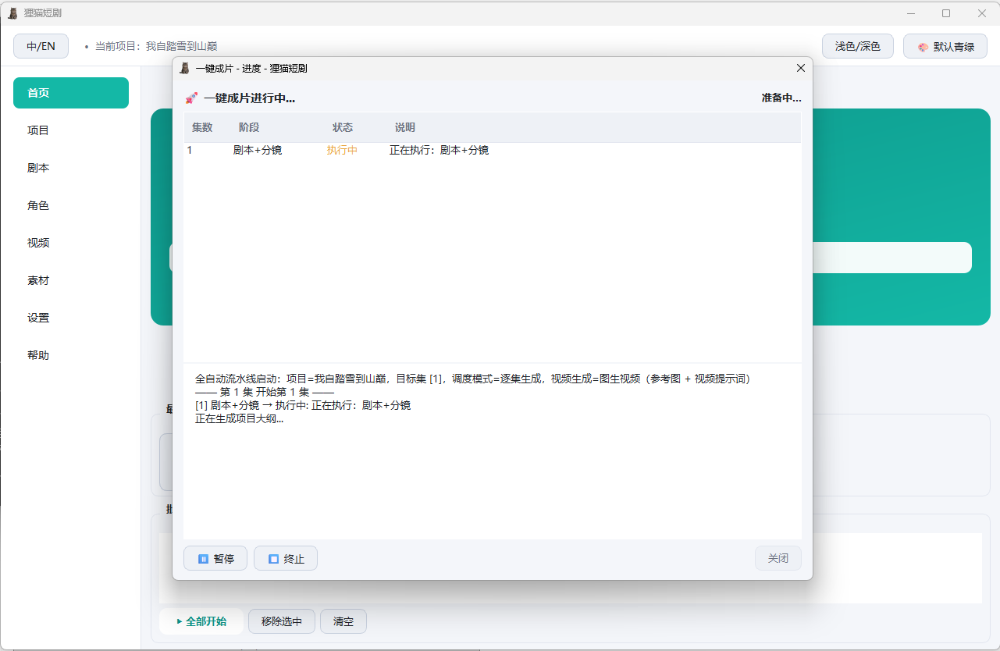
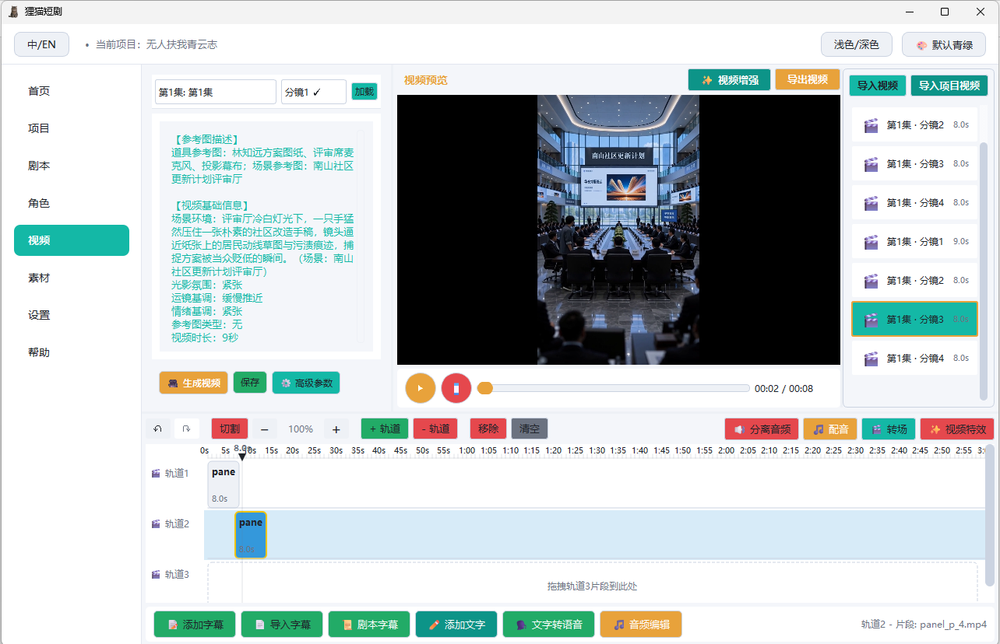
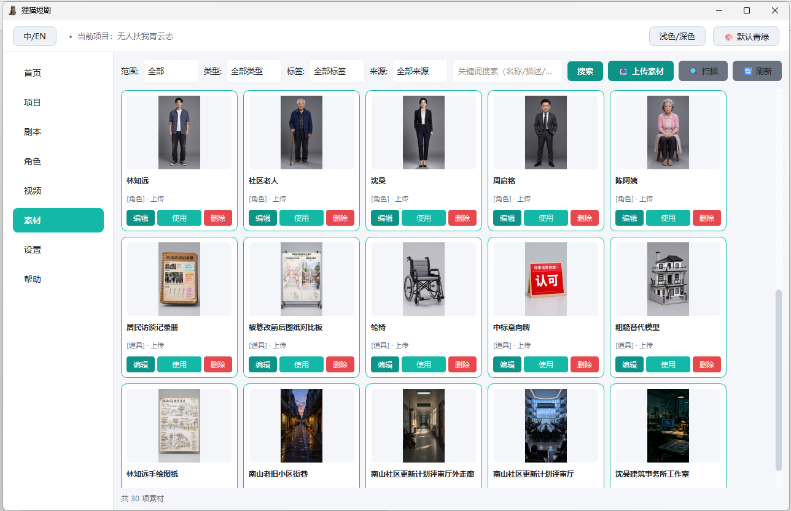
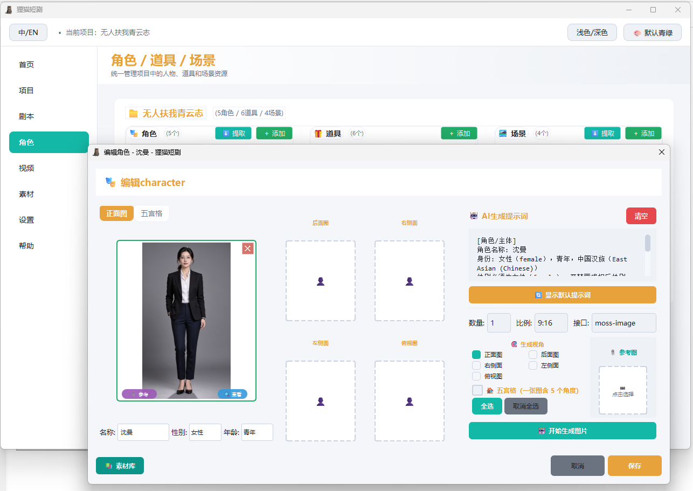
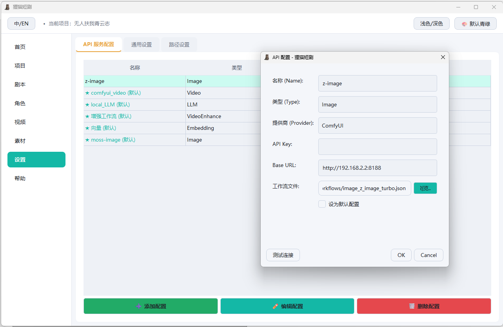

# Dragonli (狸猫短剧 / AI Short Drama Generator)

[](LICENSE)
[](https://www.python.org/downloads/)
[](https://www.riverbankcomputing.com/software/pyqt/)

**English** | [中文](README.md)

> ## Local-first · Automated · Effortlessly Simple · Versatile
>
> **An AI short-drama studio that lives on your own machine**: give it a topic and it runs the script, storyboard, video and subtitles, then exports the finished film.
>
> Keys, projects, assets and final videos all stay local. When you need it, swap in an Ollama / LM Studio + ComfyUI stack and keep the entire pipeline off the internet.
>
> Simple does not mean limited: original or adapted stories, 15 genres, mixed cloud and local models, and portrait/landscape exports for every major platform — all in one pipeline.
>
> 👉 Want to jump straight in? See the [Usage Guide](#usage).

---

## 🎯 Why Dragonli

| What matters | The usual workflow | Dragonli |
| --- | --- | --- |
| **Data & privacy** | Scripts and assets uploaded to an online platform | Projects, keys, assets and exports stay on disk; inference can run locally, fully offline |
| **Production flow** | Juggling a writing app, image tool, editor, subtitle tool and TTS | One topic → 🚀 Auto Render, four stages chained automatically |
| **Learning curve** | Environment setup, prompt engineering, editing skills | Double-click the exe → add one service → click once, all in a GUI |
| **Breadth** | One tool covers one step | Original or adapted stories, many genres and models, multiple export specs and three ways to use it — all in one pipeline |

### 🏠 Local-first · Your PC is the whole studio

- **Nothing leaves your disk**: projects are plain JSON plus media files under `resources/projects/`. No account system, no cloud sync. Copy the folder for a full backup; delete it and it is gone.
- **Your keys stay yours**: API keys are written only to the local `resources/config/config.json` (git-ignored). Requests go only to the endpoints you configure yourself.
- **You choose the inference backend**: point the LLM at a cloud API (OpenAI, DeepSeek, ...) or at a local/LAN **Ollama, LM Studio, vLLM or llama.cpp** server. Dragonli loads local models on demand, retries on failure and unloads them afterwards to free VRAM. Local servers need no real key.
- **Local image & video**: first-class **ComfyUI** support (`127.0.0.1:8188` or a LAN address) with 8 bundled workflows (image generation, image-to-video, deblur, dewatermark, frame interpolation, upscaling, ...), no API key required. Enhancement falls back to local FFmpeg when no workflow is configured.
- **Local voice & assembly**: optional offline system TTS (pyttsx3); clip concatenation, subtitle burn-in and BGM mixing all run through local FFmpeg.
- **Chinese-first**: Chinese UI with one-click English/Chinese switching, plus 15 built-in Chinese short-drama templates (rebirth, revenge, palace intrigue, sweet romance, system-flow, ...) and prompts tuned for that format.
- **Portable single file**: `Dragonli.exe` runs on double-click, unpacks resources next to itself, and never overwrites an existing config file.

> 💡 Cloud and local are both **options**. Cloud APIs may incur provider charges; switch LLM, image, video and TTS to local services and the whole pipeline can run without a network connection.

### ⚙️ Automated · One sentence to one finished video

- **🚀 Auto Render**: a topic kicks off four chained stages — `Script + storyboard (with character / scene / prop extraction and reference images)` → `Video clips` → `SRT subtitles` → `Concatenation + subtitle burn-in` — with live progress and logs.
- **Consistency on autopilot**: characters, scenes and props are extracted and given reference images automatically; video prompts carry built-in consistency constraints and rules against on-screen text, captions or watermarks; missing reference images are backfilled on resume.
- **Resume where you stopped**: per-episode, per-stage state is persisted. Restarting skips completed work instead of paying for it twice, and failed stages can be retried individually.
- **Batch queue**: queue several topics and process them sequentially; choose per-episode or per-stage scheduling.
- **Review when you want**: optional checkpoints pause at key stages for preview and confirmation. Leave them off and the pipeline runs straight through.
- **More automation**: automatic character/scene extraction, batch dubbing matched to speaker voices in the video editor, automatic local-model load and retry, automatic subtitle generation and burn-in.

### 🎈 Effortlessly Simple · Open it and use it

- **No installer, no terminal**: download `Dragonli.exe` and double-click. From source, `start.bat` or `python src/main.py` is all it takes.
- **Three steps to a video**: add one LLM service in Settings (the dialog has a built-in "Test Connection" button) → type a topic or pick a template on the home page → hit 🚀 Auto Render.
- **Everything is a GUI**: project management, script editor, character/scene/prop libraries, storyboard panels, video editor and progress dialog are all point-and-click. No prompt writing or scripting needed.
- **Simple by default, flexible when needed**: beginners use one button; advanced users still get a CLI, an HTTP API, custom ComfyUI workflows and switchable API profiles.
- **Bilingual UI** with one-click switching.

### 🧩 Versatile · Simple does not mean limited

- **Two starting points**: **Original drama** (topic + 6 style presets + 15 genre templates) or **Adapted drama** (paste/import an existing novel, then set adaptation fidelity and target platform).
- **Mix and match models**: LLM, image, video, TTS, video enhancement and Embedding are configured independently; save multiple API profiles and switch freely. Cloud APIs and local Ollama / ComfyUI can be combined, e.g. a local LLM with cloud video.
- **Several ways to generate**: fully automatic Auto Render, step-by-step manual editing, or a sequential batch queue; per-episode or per-stage scheduling, from 1 to 1000 episodes with multi-episode project management.
- **Export for every platform**: Douyin / TikTok / Kuaishou portrait 9:16, Bilibili / YouTube landscape 16:9 and custom presets, with adjustable aspect ratio, resolution, frame rate, length, language and transitions.
- **A full post-production toolset**: timeline editing, audio tracks and batch TTS dubbing, SRT burn-in, BGM mixing, plus 8 ComfyUI workflows (2 image, 1 image-to-video, 5 video enhancement).
- **Three ways in**: 8 GUI pages (Home / Projects / Script / Roles / Video / Assets / Settings / Help), a CLI and an HTTP API; Chinese/English UI, light/dark themes and multiple skins.

---

## 📥 Download & Demo

- **Windows single-file build**: download `Dragonli.exe` from [Releases](https://github.com/frank36512/dragonli/releases) and double-click to run.
- **Quark Drive mirror**: [https://pan.quark.cn/s/337e9e697935](https://pan.quark.cn/s/337e9e697935) — a faster option for users in mainland China, no GitHub account required; same `Dragonli.exe` as on Releases.
- **Screenshots / demo video**: see [Screenshots & Demo](#screenshots--demo) below.

---

<a id="screenshots--demo"></a>

## 📸 Screenshots & Demo

> The screenshots below come from the actual running app (sample project: *无人扶我青云志 / No One Helps Me Reach the Clouds*). Click any image to view it full size.

| Home · one-click auto render entry | Projects · details and outline |
| :---: | :---: |
| [](shots/1.png) | [](shots/2.png) |

| Script · storyboard editing and video prompts | Roles / Props / Scenes · consistency assets |
| :---: | :---: |
| [](shots/3.png) | [](shots/4.png) |

| Generation setup · scheduling and checkpoints | Auto Render · live progress and logs |
| :---: | :---: |
| [](shots/5.png) | [](shots/6.png) |

| Video editor · clip preview and timeline | Asset library · character / prop / scene assets |
| :---: | :---: |
| [](shots/7.png) | [](shots/8.png) |

| Character editor · reference images and AI prompts | Settings · API service configuration and test connection |
| :---: | :---: |
| [](shots/9.png) | [](shots/10.png) |

### 🎬 Demo video

[](shots/%E6%A0%B7%E7%89%871.mp4)

**Sample film: *无人扶我青云志*** (~26 s, 9:16 portrait) — [▶ Watch / download MP4](shots/%E6%A0%B7%E7%89%871.mp4) (11.6 MB)

---

## 📖 Introduction

**Dragonli (狸猫短剧)** is a locally-run AI short-drama workstation. It brings scriptwriting, character and scene setup, storyboarding, video generation, subtitles and dubbing into one automated pipeline. There is no platform account to sign up for and no need to master prompting or editing: give it a topic and let the pipeline work, while every stage stays open for manual adjustment when you want it.

Whether you are a solo creator or a small team, it helps you keep characters consistent, produce dramas in batches, and keep every asset in your own hands.

---

## ✨ Key Features

### 📝 Intelligent Script Management
- **AI-Assisted Writing**: generate scripts, dialogue and scene descriptions via OpenAI-compatible APIs or local models.
- **Format Standardization**: scripts are structured automatically so they can feed straight into storyboarding.
- **Genre Templates**: 15 built-in Chinese short-drama templates to start from.

### 🎨 Character Consistency System
- **Profile Management**: define traits, appearance and backstory.
- **Reference Images**: auto- or manually-generated references for characters, scenes and props act as anchors for image-to-video consistency.

### 🎥 AI Video Generation
- **Multiple Backends**: cloud APIs (Veo, Runway, ...) and local ComfyUI workflows side by side.
- **Image-to-Video**: clips generated from per-panel character / scene / prop references plus video prompts.
- **Video Enhancement**: deblur, dewatermark, interpolation and upscaling workflows, with a local FFmpeg fallback.

### 🗣️ Audio & Subtitles
- **TTS**: OpenAI-compatible TTS, voice cloning (sovit) and offline system TTS (pyttsx3).
- **Batch Dubbing**: match speakers to character voices in the video editor.
- **Subtitles**: SRT generated from storyboard panels and burned in during composition; custom BGM supported.

### 🎬 Visual Storyboard & Editor
- **Storyboard Panels**: shots, dialogue, camera movement, sound and mood planned second by second.
- **Video Editor**: timeline, audio tracks, dubbing and export, so you can fine-tune before or after rendering.

---

<a id="usage"></a>

## 🎬 Usage Guide

> In a hurry? Follow **A**. For step-by-step control see **B**; batch runs and resume in **C**; a fully local stack in **D**; CLI/API in **E**. The in-app **Help** page has a built-in guide too.

### A. Three steps to a finished video

**Step 1 · Add one AI service**

Go to **Settings → API Config → ➕ Add Config**, pick a type (LLM / Image / Video / TTS, ...) and provider, enter `base_url`, model name and key, click **Test Connection**, then save once it succeeds.

- Cloud: paste the API key from your provider.
- Local: set `base_url` to `http://127.0.0.1:1234/v1` (LM Studio) or `http://127.0.0.1:11434/v1` (Ollama); the key can be any placeholder such as `sk-local`.
- **One LLM config is enough to start**; image, video and TTS can be added later.

**Step 2 · Enter a topic**

Back on **Home**, choose **🎬 Original Drama** or **📖 Adapted Drama**:

- Original: pick a style (Urban / Historical / Sci-Fi / Suspense / Comedy / Romance), or click **📋 Templates** to fill in a preset genre, then type a topic such as "A delivery rider unexpectedly gains mind-reading powers".
- Adapted: paste a novel or source text, or click **Import** to load a file; adaptation fidelity and target platform are set in the next dialog.

**Step 3 · Auto Render**

Click **🚀 Auto Render** (**🎭 Adapt & Render** in adaptation mode) and configure the two-step dialog:

1. **Generation Config**: choose "per-episode" or "per-stage" scheduling, and optionally tick checkpoints (leave them off for a fully unattended run).
2. **Script Parameters**: episode count, aspect ratio, resolution, length, language, visual style, export preset / target platform, transitions and more.

The progress dialog then runs `Script + storyboard → Video clips → SRT subtitles → Composition` in order, showing per-episode, per-stage status and logs; you can pause or stop at any time.

**Where the video lands**: `resources/projects/<project>/output/episode_<n>_final.mp4`. The project folder also holds `scripts/`, `images/`, `clips/`, `subtitles/` and `audio/` intermediate artifacts, each openable and editable on its own.

### B. Step-by-step control (without the full pipeline)

The 8 sidebar pages map to the whole workflow:

| Page | What you can do |
| --- | --- |
| **Home** | Auto Render, batch queue, recent projects |
| **Projects** | Create/open projects, manage episodes, resume generation |
| **Script** | Edit scripts, AI generation and adaptation, batch-adapt episodes, generate video prompts |
| **Roles** | Manage characters / props / scenes together, auto-extract, generate reference images |
| **Video** | Storyboard clip generation, timeline editing, TTS dubbing, subtitles, BGM, export |
| **Assets** | Asset library and resource browsing |
| **Settings** | API configs, Embedding, UI language/theme, workflows |
| **Help** | Built-in guide and FAQ |

A typical order: **Projects → Script → Roles (check reference images) → Storyboard & clips → Video editor for dubbing and export**. Any single step can be redone without rerunning the whole pipeline.

### C. Batch runs, resume and checkpoints

- **Batch queue**: after entering a topic on Home, click **＋ Add to Queue**; queued topics run sequentially — handy for a whole season.
- **Resume**: after a crash or cancellation, reopen the project from Recent Projects or Projects. Completed stages are skipped automatically (`cached`) and only the remaining work runs; a failed stage can be retried on its own.
- **Checkpoints**: tick a stage in the generation dialog and the run pauses there, unlocking the main window so you can edit the script or storyboard before continuing. Off by default.

### D. A fully local stack (optional, no data leaves your machine)

| Stage | How to configure it |
| --- | --- |
| LLM | Point the LLM `base_url` at a local Ollama / LM Studio / vLLM / llama.cpp server |
| Image / Video | Add an `Image` / `Video` config, choose the **ComfyUI** provider, set `http://127.0.0.1:8188`, and select a workflow from `resources/workflows/` |
| Enhancement | Assign workflows to deblur / dewatermark / interpolation / upscaling; leave blank to fall back to local FFmpeg |
| TTS | Choose the `system` provider (offline pyttsx3), or sovit voice cloning |
| Composition | No setup needed — local FFmpeg handles concatenation and subtitle burn-in |

With everything local, no API key is required. Mixing is fine too, e.g. a local LLM with cloud video.

### E. CLI and HTTP API (advanced)

```bash
# CLI: create a project, run the full pipeline
python src/main.py --cli --task create_project --project "My Drama"
python src/main.py --cli --task full_pipeline --topic "A delivery rider gains mind-reading powers" --episodes 3

# HTTP API: interactive docs at http://127.0.0.1:18790/docs
python src/main.py --api --port 18790
```

Common endpoints: `/api/project/create`, `/api/script/generate`, `/api/video/generate`, `/api/video/compose`, `/api/pipeline/full`, `/api/pipeline/auto` plus its `/status` and `/resume`.

### 💡 Tips

- Cloud APIs are billed by usage. Test with **1 episode + a checkpoint** before queuing a batch.
- Video generation takes a while; the progress dialog log shows the current stage.
- If FFmpeg is not on PATH, the app tries the binary bundled with `imageio-ffmpeg` — check this first if export fails.
- Keys live only in the local `resources/config/config.json`. Never commit them or show them in screenshots.

---

## 🛠️ Tech Stack

- **Language**: Python 3.10+ (3.11 recommended)
- **GUI Framework**: PyQt6
- **LLM**: OpenAI-compatible APIs / DeepSeek / Ollama / LM Studio / vLLM / llama.cpp
- **Image & Video**: OpenAI-compatible image APIs, Google, Veo, Runway, local ComfyUI workflows
- **Audio**: OpenAI-compatible TTS, sovit voice cloning, pyttsx3 offline TTS
- **Media Processing**: FFmpeg, OpenCV, Pydub
- **Services & Data**: FastAPI HTTP API, CLI, JSON-based local project structure

---

## 📂 Project Structure

```text
Dragonli/
├── src/
│   ├── main.py              # GUI entry point
│   ├── cli.py               # CLI entry point
│   ├── api/                 # HTTP API (FastAPI)
│   ├── ui/                  # PyQt6 interface (Auto Render, video editor)
│   ├── core/                # Script / character / storyboard / auto pipeline / synthesis logic
│   ├── ai_engine/           # LLM, image, video and audio clients
│   ├── i18n.py              # Chinese-English UI switching
│   └── paths.py             # Runtime paths and local resource bootstrap
├── resources/
│   ├── config/              # Example config (config.example.json)
│   ├── templates/           # 15 preset drama templates
│   ├── workflows/           # ComfyUI / video-enhancement workflows
│   ├── icons/               # UI SVG icons
│   └── characters|scenes|props|projects/  # Runtime user data (not committed)
├── build_exe.spec           # PyInstaller build config
├── requirements.txt         # Python dependencies
├── start.bat                # Windows quick launch
└── LICENSE
```

---

## 🚀 Getting Started

### Prerequisites

- **Python 3.10+** (3.11 recommended).
- **FFmpeg** on your system PATH; otherwise the app falls back to the binary bundled with `imageio-ffmpeg`.
- **Windows** for the GUI and packaging script; the core logic is plain Python.
- At least **one LLM service**: a cloud API key, or a running local Ollama / LM Studio instance.

> Just want a quick look? Download `Dragonli.exe` from [Releases](https://github.com/frank36512/dragonli/releases) or the [Quark Drive mirror](https://pan.quark.cn/s/337e9e697935), skip the install steps below, and add one LLM service in Settings. See the [Usage Guide](#usage) for the full walkthrough.

### Installation

1.  **Clone the repository**:
    ```bash
    git clone https://github.com/frank36512/dragonli.git
    cd Dragonli
    ```

2.  **Create Virtual Environment**:
    ```bash
    # Windows
    python -m venv .venv
    .venv\Scripts\activate

    # Linux/macOS
    python3 -m venv .venv
    source .venv/bin/activate
    ```

3.  **Install Dependencies**:
    ```bash
    pip install -r requirements.txt
    ```

### Configuration

Copy the example config and add the API keys for the services you plan to use. For a local model, set `base_url` to something like `http://127.0.0.1:1234/v1`; the key can be any placeholder value.

```bash
# Windows
copy resources\config\config.example.json resources\config\config.json

# Linux/macOS
cp resources/config/config.example.json resources/config/config.json
```

> ⚠️ `resources/config/config.json` and all `*.bak*` backups are git-ignored. Never force-add them, and never put real keys into `config.example.json`, issues, PRs, logs or screenshots.

### Running

```bash
python src/main.py                      # GUI
start.bat                               # Windows quick launch
python src/main.py --cli --help         # CLI mode
python src/main.py --api --port 18790   # HTTP API, interactive docs at /docs
```

### Packaging (Windows)

```bash
python -m PyInstaller build_exe.spec --noconfirm --clean
# Output: dist/Dragonli.exe
```

---

## 🔐 Privacy & Security

- API keys are kept in a local config file; requests are sent only to providers you configure. Switch to local inference and no data needs to leave your machine.
- Using cloud AI services may incur costs, which are your responsibility.
- You are responsible for reviewing the copyright and compliance of generated content.
- Never commit keys, project data under `resources/projects/`, or generated media. If a key may have leaked, rotate it immediately with the provider.

## ⚠️ Disclaimer

This project is not officially affiliated with OpenAI, Google, DeepSeek or any other provider; model names are used only to describe compatibility. The software is provided "as is", without warranty of any kind.

---

## 🗺️ Roadmap

- [x] **Phase 1: Foundation** - Basic UI, local project management, script editor.
- [x] **Phase 2: AI Core** - LLM scriptwriting, character / scene / prop extraction and reference-image consistency.
- [x] **Phase 3: Video Synthesis** - Image-to-video clip pipeline with local ComfyUI workflows.
- [x] **Phase 4: Subtitles & Audio** - Automatic SRT generation and burn-in, TTS dubbing, BGM mixing.
- [x] **Phase 5: Polish** - Auto Render, resume, batch queue, timeline editing and export.
- [ ] **Planned** - Wire the existing Veo lip-sync / SFX clients into the Auto Render pipeline; lip movement currently relies on the video model itself.

---

## 🤝 Contributing

Contributions are welcome! Please read [CONTRIBUTING.md](CONTRIBUTING.md) for the development setup and pull request process.

---

## 📬 Contact

- **Bugs & feature requests**: please open a [GitHub Issue](https://github.com/frank36512/dragonli/issues) so the discussion stays searchable.
- **Email**: [frank36512@gmail.com](mailto:frank36512@gmail.com) for collaboration, questions, or anything you would rather not post publicly.

---

## 📄 License

This project is licensed under the Apache License 2.0 - see the [LICENSE](LICENSE) file for details.
